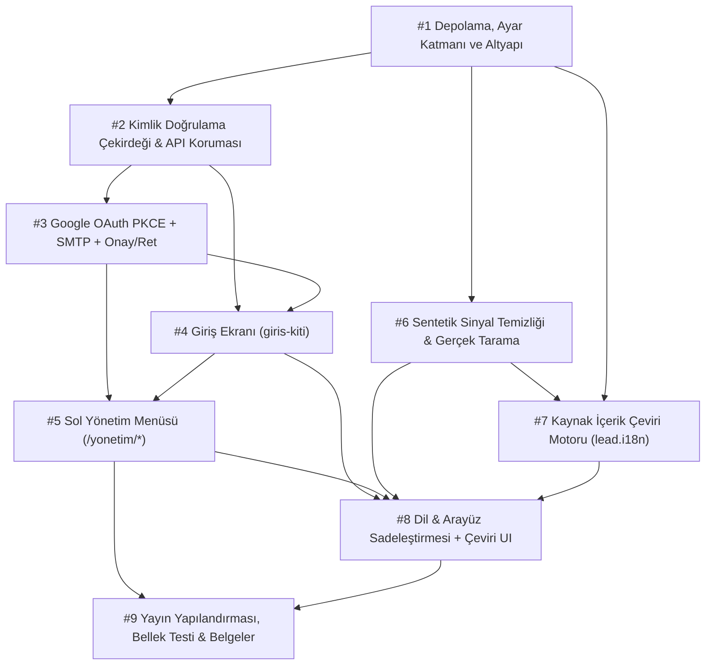

# AI-CustomerHunter — AppCook Uyumu, Arayüz Sadeleştirme ve TR/EN İçerik Çevirisi İş Listesi

Durum özeti: 0/9 tamamlandı · Güncelleme: 2026-11-19

## Problem ve kapsam

**Problem:** `AI-CustomerHunter` (`https://customerhunter.appcook.store`) şu an kimlik doğrulamasız (herkese açık), geliştirici/SaaS jargonu ve sahte fiyatlandırma (`$19/$49/$99`) içeren, 7 dilli ancak yalnızca arayüz etiketlerini çeviren ve canlı taramada sentetik/uydurma Reddit sinyali üreten bir yapıdadır. Satış/KOBİ/iş geliştirme odaklı ekip üyelerinin güvenle oturum açıp ortak fırsat havuzunda gerçek Reddit/HackerNews/GitHub müşterilerini kendi dilinde (TR/EN) okuyup yanıtlayabilmesi gerekiyor.

**Kapsam:**
1. **AppCook Yönetim Standardı:** Google OAuth 2.0 (PKCE+OIDC) + yerel yönetici girişi (2FA yok), yönetici onayı, tek kullanımlık onay/ret e-posta akışı (`nodemailer` MIT-0), oturum öncesi `AppCook/giris-kiti` giriş ekranı (`/giris`) ve yalnızca yöneticilerin erişebildiği sol yönetim menüsü (`/yonetim/*`).
2. **Ortak ekip havuzu:** Onaylanan tüm aktif kullanıcılar aynı `campaigns` ve `leads` havuzunu görür ve günceller.
3. **Arayüz sadeleştirmesi:** `Global SaaS Landing`, sahte `$19/$49/$99` fiyatlandırma, sahte `Twitter/X` filtresi ve kullanıcı sekmesindeki `Webhooks & Plan Billing` kaldırılır; 4 net sekme (**Fırsatlar**, **Müşteri Takibi**, **Rakip Şikayetleri**, **Ürün Ekle**) ve sade satış/KOBİ dili uygulanır; ayarlar `/yonetim` sol menüsüne taşınır.
4. **TR/EN dil sadeleştirmesi:** `de, es, fr, ja, zh` dil dosyaları silinir; `public/app.js:17-140` içindeki ölü `I18N` kodu temizlenir; yalnızca TR ve EN desteklenir.
5. **Kaynak içerik çevirisi:** Reddit/HN/GitHub başlık, özet, "Neden sıcak?" ve niyet etiketi aktif arayüz dilinde (TR/EN) gösterilir. Çeviri zinciri: `lead.i18n` kalıcı önbellek → LLM API (panelden ayarlanabilir) → MyMemory ücretsiz API → Orijinal metin (resmi olmayan `gtx` **kullanılmaz**). "Hazır Yanıt Taslağı" kopyalanabilir olarak gönderinin orijinal dilinde (EN) sunulur; arayüz TR iken altında Türkçe anlam önizlemesi ve TR/EN geçiş düğmesi bulunur.
6. **Gerçek tarama verisi:** `server.js:703-733` içindeki sentetik/uydurma Reddit sinyali ve sahte `X Live Intent Stream` etiketi kaldırılır; yalnızca gerçek Reddit/HN/GitHub sonuçları eklenir.

**Kapsam dışı:**
- Kullanıcı bazlı kampanya/fırsat izolasyonu (`ownerId` ayrımı — ortak ekip havuzu seçildi).
- X (Twitter) ücretli API entegrasyonu veya otomatik gönderi/yorum paylaşımı (spam/ban riski).
- Yönetici veya kullanıcı için 2FA / TOTP.
- Ödeme/abonelik altyapısı ve self-hosted LibreTranslate servisi (`256m` bellek sınırı nedeniyle).
- Resmi olmayan Google Translate `gtx` uç noktası.

## Açık sorular

İşin bölünüşünü değiştiren açık soru yoktur; 6 ana ürün kararı kesinleştirilmiştir.

## Varsayımlar

1. **Veri dosyalarının ayrımı:** Mevcut `/data/db.json` yalnızca `campaigns` ve `leads` verilerini tutmaya devam eder; kullanıcı hesapları/token geçmişi `DATA_DIR/auth.json`, yönetim ayarları (Google OAuth, SMTP, LLM/Çeviri, Webhook) `DATA_DIR/settings.json` dosyasında atomik yazımla saklanır.
2. **İstemci URL yönlendirmesi:** Oturumsuz kullanıcı `/` veya herhangi bir uygulama sayfasına girdiğinde `/giris`'e (`302`) yönlendirilir; `/api/*` uç noktaları (`/api/health` hariç) oturumsuz çağrılırsa `401 JSON` döner.
3. **LLM sağlayıcı desteği:** `/yonetim/yapay-zeka` panelinde Anthropic, OpenAI uyumlu ve Gemini API'lerinden biri seçilebilir; anahtar girilmemişse sistem otomatik olarak MyMemory ücretsiz API'sine (yönetici e-postası `de=` parametresiyle) düşer, kota/hata halinde orijinal metni bozmadan gösterir.
4. **Canlı yayın ortamı:** Hostinger sunucusundaki Google Cloud Console OAuth yönlendirme adresi (`https://customerhunter.appcook.store/auth/google/callback`) ve `/opt/customerhunter/.env` değerleri yayın sırasında yapılandırılacaktır.
5. **Mevcut örnek kayıtlar (`INITIAL_LEADS`):** `server.js:192-391` içindeki 9 AppCook portföy örneği (8 Reddit, 1 HN) ilk açılışta ekranın boş kalmaması için korunur ve gömülü statik `i18n.tr` + `i18n.en` çevirileriyle gelir (0 dış API çağrısı).

---

## İş kalemleri

### #1 Kalıcı depolama, ayar katmanı ve bağımlılık altyapısı  [arka uç] [veritabani] · Boyut: K · Durum: bekliyor
- **Amaç:** `db.json` bozulmasını önleyen atomik yazım + kayıt sınırı eklemek, AppCook standart `auth.json` / `settings.json` (`.env` öncelik/yedek + gizli alan maskeleme) modülünü kurmak ve `nodemailer` (MIT-0) bağımlılığını Docker derlemesine dahil etmek.
- **Yapılacaklar:**
  - `lib/store.js` oluştur: atomik JSON okuma/yazma (`<dosya>.tmp` → `fs.renameSync`), `DATA_DIR/auth.json` ve `DATA_DIR/settings.json` erişimi, `.env` fallback ve API yanıtları için gizli alan maskeleme (`googleClientSecret`, `smtpPass`, `llmApiKey`).
  - `server.js:470-504` içindeki `loadDb()` / `saveDb()` işlevlerini atomik yazıma geçir; `db.leads` boyutunu şişmeye karşı sınırla (ör. toplam maks 300 kayıt; `replied` ve `converted` durumundakiler öncelikli korunur).
  - `package.json`'a yalnızca `nodemailer` (MIT-0, 0 alt bağımlılık) ekle; `Dockerfile:5-8` içine `package-lock.json` + `npm ci --omit=dev` ve `COPY lib ./lib` ekle.
  - `.env.example` oluştur (`PORT`, `DATA_DIR`, `PUBLIC_URL`, `SECRET_KEY`, `ADMIN_USERNAME`, `ADMIN_PASSWORD`, `ADMIN_EMAILS`, `GOOGLE_CLIENT_ID`, `GOOGLE_CLIENT_SECRET`, `SMTP_*`, `LLM_*`).
- **Kabul ölçütleri:**
  - [ ] Eşzamanlı yazma/yeniden başlatma sonrası `db.json`, `auth.json` ve `settings.json` dosyaları bozulmadan okunur.
  - [ ] `settings.json` içindeki değerler `.env` değerlerine baskın gelir; gizli anahtarlar maskeli döndürülür ve boş gönderildiğinde mevcut gizli değer silinmez.
  - [ ] `db.leads` 300 kaydı aştığında eski `new` kayıtlar temizlenir, `replied`/`converted` kayıtlar korunur.
  - [ ] `Dockerfile` ile oluşturulan imaj `nodemailer` modülünü yükleyerek sorunsuz başlar.
- **Etkilenen dosyalar:** `lib/store.js` (yeni), `server.js:470-504`, `package.json`, `package-lock.json` (yeni), `Dockerfile:1-25`, `.env.example` (yeni)
- **Bağımlılık:** yok
- **Test:** Node birim betiği ile atomik yazım, `.env`/settings önceliği, maskeleme ve 300+ lead budama doğrulaması; `docker build` kontrolü.
- **Kapsam dışı:** OAuth, oturum çerezi veya arayüz değişiklikleri.

---

### #2 Kimlik doğrulama çekirdeği: yerel yönetici girişi, oturum çerezi ve API koruması  [arka uç] · Boyut: O · Durum: bekliyor · **Riskli: `guvenlik-uzmani` + `kod-inceleyici`**
- **Amaç:** Saf Node.js 22 (`node:crypto`) ile AppCook standardına uygun oturum yönetimini, ilk yönetici kurulumunu, kaba kuvvet korumasını ve tüm API uç noktalarının oturum korumasını sağlamak.
- **Yapılacaklar:**
  - `lib/auth.js` oluştur:
    - `SECRET_KEY` yoksa `DATA_DIR/secret.key` (`0600`) otomatik üretimi.
    - HS256 JWT `sign()`/`verify()` (`pur`, `uid`, `tv`, `iat`, `exp`, `jti`); çerez adı HTTPS (`PUBLIC_URL=https://...`) iken `__Host-customerhunter_oturum` (`HttpOnly; Secure; SameSite=Lax; Path=/`), yerelde `customerhunter_oturum`.
    - İlk yönetici oluşturma (`ADMIN_USERNAME` varsayılan `admin`, `ADMIN_PASSWORD` yoksa rastgele üretilip `DATA_DIR/ilk-yonetici.txt` `0600` yazılır ve ilk başarılı girişte silinir). Parola özeti PBKDF2-HMAC-SHA256 (600.000 tur) + `timingSafeEqual`. Yöneticiye 2FA **yoktur**.
    - Süreç içi `Map` tabanlı kaba kuvvet koruması (15 dk'da hesap+IP 10, IP 100 deneme).
    - `requireAuth(req, res)` ve `requireAdmin(req, res)` ara katmanları: her istekte kullanıcının `status === "active"` ve `token_version === tv` olduğu doğrulanır.
  - `server.js:910-1007` rotalarını koru:
    - Açık kalanlar: `GET /api/health`, `GET /giris`, `POST /auth/local/login`, `POST /auth/logout`, statik giriş varlıkları.
    - `GET /api/auth/me` ekle (aktif kullanıcının ad, e-posta, rol bilgisi).
    - Mevcut `/api/state`, `/api/analyze-url`, `/api/campaigns`, `/api/scan`, `/api/leads/:id` uç noktalarına `requireAuth` uygula (ortak ekip havuzu: tüm aktif kullanıcılar erişir).
    - Eski `PUT /api/settings` uç noktasını `requireAdmin` korumasına al (veya `/api/yonetim/*` altında topla).
- **Kabul ölçütleri:**
  - [ ] Oturumsuz istemci `/api/state`, `/api/scan`, `/api/campaigns`, `/api/leads/:id` veya `/api/analyze-url` çağırdığında `401` döner; `/api/health` `200` döner.
  - [ ] İlk açılışta kullanıcı yoksa `admin` hesabı ve `DATA_DIR/ilk-yonetici.txt` oluşur; yerel yönetici girişi başarılı olunca oturum çerezi atanır ve `ilk-yonetici.txt` silinir.
  - [ ] 15 dakika içinde 10 başarısız denemeden sonra giriş `429` ile engellenir.
  - [ ] `POST /auth/logout` veya kullanıcının `token_version` artışı sonrası eski oturum çerezi reddedilir.
  - [ ] Onaylı iki farklı aktif kullanıcı aynı kampanya ve fırsat havuzunu okuyup güncelleyebilir.
- **Etkilenen dosyalar:** `lib/auth.js` (yeni), `server.js:875-1033`
- **Bağımlılık:** #1
- **Test:** `curl` / Node test betiği ile 401/200 koruması, ilk yönetici girişi, `ilk-yonetici.txt` silinmesi, rate limit (429), çıkış sonrası çerez geçersizliği ve `token_version` iptali.
- **Kapsam dışı:** Google OAuth akışı, SMTP gönderimi, giriş arayüzü HTML'i.

---

### #3 Google OAuth 2.0 (PKCE+OIDC), SMTP e-posta ve yönetici onay/ret akışı  [arka uç] · Boyut: O · Durum: bekliyor · **Riskli: `guvenlik-uzmani` + `kod-inceleyici`**
- **Amaç:** Kullanıcıların Google ile giriş yapmasını, `ADMIN_EMAILS` dışındakilerin `pending` statüsüyle yönetici onayına düşmesini, yöneticilere tek kullanımlık imzalı onay/ret e-postası gitmesini ve karar sonrası başvurana bilgi e-postası gönderilmesini sağlamak.
- **Yapılacaklar:**
  - `lib/mailer.js` oluştur (`nodemailer` MIT-0): STARTTLS (587) / SSL (465) desteği, Gmail 16 haneli uygulama şifresindeki boşlukları otomatik temizleme, düz metin + düğmeli HTML (`multipart/alternative`) şablonları (yöneticiye yeni başvuru bildirimi, başvurana onaylandı/reddedildi e-postası, deneme e-postası), arka planda hata yakalamalı gönderim.
  - `lib/auth.js` ve `server.js` içine Google OAuth + onay rotalarını ekle:
    - `GET /auth/google/start`: PKCE (`S256`), `state`, `nonce` üretip 600 sn imzalı `oidc` çerezine yazar; `accounts.google.com/o/oauth2/v2/auth` (`scope=openid email profile`, `prompt=select_account`) adresine yönlendirir.
    - `GET /auth/google/callback`: `state`/`oidc` çerezini doğrular, `oauth2.googleapis.com/token` ile kodu değişir, `id_token` içinde `iss`, `aud`, `exp`, `nonce`, `sub`, `email_verified` doğrular.
    - E-posta `ADMIN_EMAILS` listesindeyse kullanıcı doğrudan `active` + `admin` olur; değilse ilk kez geliyorsa `pending` + `user` açılır, yöneticilere 14 gün geçerli tek kullanımlık (`jti`) imzalı `/onay?t=...&karar=onayla|reddet` linkli e-posta gider ve kullanıcı `/giris?durum=bekliyor` adresine yönlendirilir.
    - `GET /onay`: E-posta önizleme botlarını engellemek için işlemi uygulamadan onay/ret düğmeli HTML form gösterir.
    - `POST /onay`: İmzalı token ve `jti` tek kullanımlık kaydını (`auth.json` → `usedTokens`) doğrular, kullanıcı durumunu `active` veya `rejected` yapar, `jti`'yi işaretler (süresi dolanları temizler) ve başvurana onay/ret e-postası gönderir.
- **Kabul ölçütleri:**
  - [ ] Google OAuth başlatıldığında `code_challenge_method=S256`, `state` ve `nonce` parametreleri gönderilir; `state` veya `nonce` uyuşmazlığında giriş reddedilir.
  - [ ] `ADMIN_EMAILS` dışındaki yeni Google kullanıcısı `pending` olarak kaydedilir, oturum çerezi almaz ve yöneticilere onay/ret linkli e-posta tetiklenir.
  - [ ] `GET /onay?t=...` yalnızca onay formu gösterir (durumu değiştirmez); `POST /onay` kullanıcıyı onaylar/reddeder, başvurana e-posta gönderir ve aynı token ikinci kez kullanıldığında reddedilir.
  - [ ] `ADMIN_EMAILS` içindeki Google hesabı doğrudan `active` yönetici olarak oturum açar.
- **Etkilenen dosyalar:** `lib/mailer.js` (yeni), `lib/auth.js`, `server.js`
- **Bağımlılık:** #2
- **Test:** Sahte OIDC token / callback doğrulama birim testleri, `GET /onay` vs `POST /onay` tek kullanımlık `jti` testi ve yerel/SMTP test sunucusuyla e-posta gönderim doğrulaması.
- **Kapsam dışı:** Giriş ve yönetim paneli arayüz tasarımları.

---

### #4 Giriş ekranı (`AppCook/giris-kiti`) ve oturum öncesi yönlendirme  [ön yüz] [arka uç] · Boyut: K · Durum: bekliyor
- **Amaç:** `AppCook/giris-kiti` ve `AppCook/standart` varlıklarını projeye dahil ederek oturum açmamış kullanıcılara müşteri bulma vitrinli standart AppCook `/giris` ekranını sunmak. *(Ön yüz: `arayuz-tasarimci` şablonuna uyumludur.)*
- **Yapılacaklar:**
  - `C:\Projects\AppCook\giris-kiti\` (`appcook-giris.css`, `appcook-giris.js`, `appcook-fonts/*` ve `OFL.txt`) ile `C:\Projects\AppCook\standart\` (`appcook-tema.css`, `appcook-kabuk.js`) dosyalarını `public/appcook/` altına kopyala.
  - `public/giris.html` (veya sunucu taraflı şablon) oluştur: `body.ac` + `.ac-sahne`, solda `.ac-bento` (müşteri bulma odaklı 3 sade özellik kartı: Gerçek Zamanlı Fırsatlar, Rakip Şikayetleri, Türkçe/İngilizce Hazır Yanıtlar), sağda `.ac-form` (Google ile Giriş düğmesi — yapılandırılmamışsa bilgilendirme notu — ve açılır `
` içinde yerel yönetici girişi formu).
  - `/giris` üzerinde `?durum=bekliyor`, `?durum=reddedildi`, `?hata=...` parametrelerine göre anlaşılır TR/EN durum kutuları göster.
  - `server.js:1009-1032` statik sunumunda: oturumu olmayan kullanıcının `/` isteğini `302 /giris`'e yönlendir; oturumu olan kullanıcının `/giris` isteğini `302 /`'a yönlendir; `/appcook/*`, `/ceviri.js`, `/ceviri/tr.js`, `/ceviri/en.js`, `/manifest.json` giriş sayfası için erişilebilir olsun.
- **Kabul ölçütleri:**
  - [ ] Oturumsuz kullanıcı `/` adresine girdiğinde `/giris` ekranına yönlendirilir ve `AppCook/giris-kiti` tasarımlı sayfayı (sol bento + sağ giriş formu) görür.
  - [ ] Google ile giriş düğmesi `/auth/google/start`'a gider; açılır yerel yönetici girişi formu çalışır ve hatalı parolada Türkçe/İngilizce uyarı gösterir.
  - [ ] Onay bekleyen veya reddedilen kullanıcı `/giris` ekranında net durum mesajı görür.
  - [ ] Aktif oturumu olan kullanıcı `/giris`'e giderse doğrudan ana çalışma alanına (`/`) yönlendirilir.
- **Etkilenen dosyalar:** `public/appcook/*` (yeni kopya), `public/giris.html` (yeni), `server.js:1009-1032`
- **Bağımlılık:** #2, #3
- **Test:** Tarayıcıda oturumsuz `/` → `/giris` yönlendirmesi, yerel yönetici girişi ile `/` açılışı, `?durum=bekliyor` görünümü, konsol/404 font hatası olmaması.
- **Kapsam dışı:** Ana çalışma alanı sadeleştirmesi (#8) ve `/yonetim` paneli (#5).

---

### #5 Sol yönetim menüsü (`/yonetim/*`) ve yönetici ayarları  [ön yüz] [arka uç] · Boyut: O · Durum: bekliyor · **Riskli: `guvenlik-uzmani` + `kod-inceleyici`**
- **Amaç:** Yalnızca yöneticilerin erişebildiği AppCook standart sol yönetim menüsünü (`/yonetim/*`) ve arka uç API'lerini kurmak; kullanıcı onay/yönetim, Google OAuth, SMTP, Yapay Zekâ/Çeviri API ve Webhook ayarlarını bu panele taşımak. *(Ön yüz: `arayuz-tasarimci` şablonuna uyumludur.)*
- **Yapılacaklar:**
  - `lib/yonetim.js` oluştur ve `server.js`'e bağla (`requireAdmin` zorunlu; yönetici olmayan kullanıcı `/yonetim*` için `403` veya `/` yönlendirmesi, `/api/yonetim/*` için `403 JSON` alır):
    - `GET /api/yonetim/ozet`: toplam/aktif/bekleyen kullanıcı, kampanya ve fırsat sayıları, aktif çeviri sağlayıcısı durumu.
    - `GET /api/yonetim/kullanicilar` ve `POST /api/yonetim/kullanicilar/:id/:action` (`onayla`, `reddet`, `yonetici_yap`, `kullanici_yap`, `oturumlari_kapat`, `sil` — kendi hesabını silme/yetkisizleştirme korumalı; onay/ret e-postası tetikler).
    - `GET /api/yonetim/ayarlar` (gizli alanlar maskeli) ve `PUT /api/yonetim/ayarlar` (Google OAuth, `ADMIN_EMAILS`, SMTP, LLM sağlayıcı/model/API anahtarı, MyMemory e-posta adresi, Slack/Discord webhook).
    - `POST /api/yonetim/eposta-test`: yapılandırılmış SMTP ile deneme e-postası gönderir.
    - `POST /api/yonetim/ceviri-test`: yapılandırılmış LLM veya MyMemory ile örnek kısa metni çevirip sağlayıcı/süre bilgisini döner.
  - `public/yonetim.html` ve `public/yonetim.js` (AppCook `appcook-tema.css` + `appcook-kabuk.js` ile sol menü):
    - Menü sırası: **Genel bakış** (`/yonetim`), **Kullanıcılar** (`/yonetim/kullanicilar` + bekleyen sayaç rozeti), **Giriş yöntemleri** (`/yonetim/giris`), **E-posta** (`/yonetim/eposta`), **Yapay zekâ / Çeviri** (`/yonetim/yapay-zeka`), ayraç + **Bildirimler (Webhook)** (`/yonetim/webhook`), alt kısımda **← Uygulamaya dön** (`/`).
- **Kabul ölçütleri:**
  - [ ] Standart (`user`) rolündeki oturumlu kullanıcı `/yonetim` veya `/api/yonetim/*` adresine erişemez (`403`).
  - [ ] Yönetici `/yonetim/kullanicilar` sayfasında bekleyen kullanıcı sayısını rozette görür; "Onayla" veya "Reddet" tıklayınca kullanıcı durumu güncellenir ve e-posta tetiklenir.
  - [ ] Yönetici `/yonetim/giris`, `/yonetim/eposta` ve `/yonetim/yapay-zeka` ayarlarını kaydedebilir; sayfa yenilendiğinde gizli anahtarlar maskeli görünür ve yeniden kaydetmede boş bırakılırsa mevcut gizli değer korunur.
  - [ ] "Deneme e-postası gönder" ve "Çeviriyi test et" düğmeleri canlı sonuç/hata mesajı gösterir.
- **Etkilenen dosyalar:** `lib/yonetim.js` (yeni), `public/yonetim.html` (yeni), `public/yonetim.js` (yeni), `server.js`
- **Bağımlılık:** #3, #4
- **Test:** Yönetici ve standart kullanıcı oturumlarıyla `/yonetim/*` yetki testi, kullanıcı onay/ret/oturum kapatma testi, gizli alan maskeleme testi, SMTP/çeviri test düğmesi kontrolü.
- **Kapsam dışı:** Ana çalışma alanındaki 4 kullanıcı sekmesi (#8).

---

### #6 Sentetik Reddit sinyalinin kaldırılması ve gerçek tarama iyileştirmesi  [arka uç] · Boyut: K · Durum: bekliyor
- **Amaç:** Canlı taramada üretilen uydurma/sentetik Reddit kaydını ve sahte X kaynağı etiketini kaldırarak yalnızca gerçek Reddit, HackerNews ve GitHub sonuçlarının gelmesini sağlamak.
- **Yapılacaklar:**
  - `server.js:703-733` içindeki `syntheticHighIntent` bloğunu tamamen sil; `scanLiveSources(campaign)` yalnızca gerçek HN, Reddit ve GitHub sonuçlarını (`discovered.slice(0, 8)`) döndürsün.
  - `server.js:970-982` (`POST /api/scan`) içinde:
    - Tekilleştirmeyi `url` veya `id` + `title` üzerinden yap.
    - Yeni gerçek sonuç yoksa (`uniqueNew.length === 0`) eski `uniqueNew.length > 0 ? uniqueNew : [freshLeads[0]]` zorlamasını kaldır; `addedCount: 0`, `leads: []` ve açıklayıcı durum bilgisi döndür (boş `freshLeads` durumunda `undefined` eklenmesini engelle).
    - `scannedSources` dizisinden `'X Live Intent Stream'` ifadesini kaldır (`['Reddit JSON API', 'HackerNews Algolia API', 'GitHub Issues API']`).
    - `server.js:1039` açılış logundaki `+ X` ifadesini temizle.
  - `POST /api/campaigns` (`server.js:957-960`) içinde `freshLeads` boş dönerse hata vermeden kampanyayı kaydet.
- **Kabul ölçütleri:**
  - [ ] `POST /api/scan` çalıştırıldığında `lead-synth-*` veya `u/growth_cto_sf` benzeri uydurma kayıt kesinlikle üretilmez.
  - [ ] Dış kaynaklar yeni eşleşme döndürmediğinde veya geçici erişilemediğinde sunucu çökmez; `ok: true, addedCount: 0, leads: []` döner ve `db.leads` içine `null`/`undefined` eklenmez.
  - [ ] `POST /api/scan` yanıtındaki `scannedSources` yalnızca gerçek kaynakları (Reddit, HackerNews, GitHub) listeler.
- **Etkilenen dosyalar:** `server.js:583-734`, `server.js:956-983`, `server.js:1035-1041`
- **Bağımlılık:** #1
- **Test:** `POST /api/scan` çağrısıyla dönen tüm kayıtların gerçek dış URL'ye sahip olduğu ve `lead-synth-` içermediği doğrulanır; dış ağ kapalı/boş senaryoda `addedCount: 0` ile temiz yanıt testi.
- **Kapsam dışı:** Çeviri motoru (#7) ve ön yüz değişiklikleri (#8).

---

### #7 Kaynak içerik çeviri motoru (`lead.i18n` önbellek → LLM API → MyMemory → Orijinal)  [arka uç] · Boyut: O · Durum: bekliyor · **Riskli: `kod-inceleyici`**
- **Amaç:** Reddit/HN/GitHub gönderilerinin başlık, özet, "Neden sıcak?", niyet etiketi ve yanıt taslağı Türkçe önizlemesini kalıcı önbellekli, yasal ve kesintisiz çeviri zinciriyle sunmak.
- **Yapılacaklar:**
  - `lib/translate.js` oluştur:
    - **1. Katman (`lead.i18n[lang]`):** Alan zaten çevrilmişse dış API çağrısı yapılmaz.
    - **Hızlı dil algılama:** Metin zaten hedef dildeyse (`tr` karakter/kelime kontrolü) dış çağrı atlanır.
    - **Sabit sözlük:** `intentLabel` (`Competitor Churn Signal`, `Active Tool Request`, `Budget-Ready Buyer`, `Workflow Pain Point` vb.) ve `banRisk` ifadeleri için anında 0 maliyetli TR/EN eşleştirme.
    - **2. Katman (LLM API — öncelikli, varsa):** `settings.json` / `.env` üzerinden yapılandırılan Anthropic / OpenAI uyumlu / Gemini API ile tek bir toplu JSON isteğinde `title`, `snippet`, `whyHot` ve (hedef `tr` ise) seçili/tüm yanıt taslaklarının Türkçe anlam önizlemesi (`repliesPreview`) çevrilir.
    - **3. Katman (MyMemory ücretsiz API — fallback):** LLM anahtarı yoksa veya hata verirse `api.mymemory.translated.net/get?q=...&langpair=en|tr&de=<eposta>` çağrılır; 450 bayt sınırı için cümle bazlı parçalama uygulanır. **Resmi olmayan `gtx` uç noktası kesinlikle eklenmez.**
    - **4. Katman (Orijinal metin):** MyMemory kotası dolarsa (`429`) veya erişilemezse orijinal metin bozulmadan döner (`provider: "original"` — sonraki denemede tekrar çevrilebilmesi için kalıcı başarılı cache olarak işaretlenmez).
  - `server.js:192-391` içindeki 9 hazır `INITIAL_LEADS` kaydına statik `i18n: { tr: { ... }, en: { ... } }` (başlık, özet, `whyHot`, `intentLabel`, `repliesTr`) göm; `syncPortfolioDb()` mevcut kurulumlardaki `INITIAL_LEADS` kayıtlarına eksik `i18n` alanını tamamlasın.
  - `POST /api/scan` ve `POST /api/campaigns` sonrası yeni bulunan gerçek lead'leri 1 kez hedef dilde çevirip `db.json`'a yaz.
  - `GET /api/state?lang=tr|en` ve `POST /api/translate` (isteğe bağlı lazy çeviri: istek başına maks 10 kayıt, eşzamanlılık sınırı 2; ayrıca tek bir lead'in yanıt taslağı önizlemesini isteğe bağlı çevirme) uç noktalarını ekle.
- **Kabul ölçütleri:**
  - [ ] 9 hazır AppCook fırsatı ilk açılışta hiçbir dış API çağrısı yapmadan hem TR hem EN dilinde eksiksiz görünür.
  - [ ] Yeni taramadan gelen İngilizce Reddit/HN/GitHub fırsatı `lang=tr` istendiğinde 1 kez çevrilip `lead.i18n.tr` içine kaydedilir; sonraki sayfa yenilemelerinde dış API'ye tekrar gidilmez.
  - [ ] LLM API anahtarı varken LLM kullanılır; anahtar yokken MyMemory (450 bayt parçalama ile) kullanılır; her ikisi de başarısızsa hata vermeden orijinal metin döner.
  - [ ] Kod tabanında `translate.googleapis.com` veya `client=gtx` çağrısı bulunmaz.
- **Etkilenen dosyalar:** `lib/translate.js` (yeni), `server.js:192-470`, `server.js:919-983`
- **Bağımlılık:** #1, #6
- **Test:** Birim testleri (önbellek isabeti, dil algılama, 450 bayt parçalama, LLM → MyMemory → Orijinal fallback sırası, 429 hata toleransı) + gerçek tarama sonrası `db.json` içinde `lead.i18n.tr` kalıcılık kontrolü.
- **Kapsam dışı:** Ön yüz dil seçici ve yanıt önizleme arayüzü (#8).

---

### #8 Dil sadeleştirme (7 → 2 dil), müşteri kovalayan arayüz sadeleştirmesi ve çeviri entegrasyonu  [ön yüz] · Boyut: O · Durum: bekliyor
- **Amaç:** 5 gereksiz dili, teknik jargonu, sahte fiyatlandırmayı ve ölü kodu temizleyip; satış/KOBİ kullanıcısına uygun 4 sekmeli, TR/EN dinamik içerik çevirili ve yanıt önizlemeli çalışma alanını sunmak. *(Ön yüz: `arayuz-tasarimci` şablonuna uyumludur.)*
- **Yapılacaklar:**
  - **7 → 2 dil temizliği:**
    - `public/ceviri/de.js`, `es.js`, `fr.js`, `ja.js`, `zh.js` dosyalarını sil.
    - `public/ceviri.js:9` içinde `DILLER = ["tr", "en"]` yap; dil değiştiğinde sayfayı yenilemeden veya yenileyerek `window.__appcookLang` üzerinden dinamik lead görünümünü güncelle.
    - `public/app.js:17-140` içindeki eski `I18N` nesnesini ve `setLanguage()` ölü kodunu tamamen sil.
    - `public/ceviri/tr.js` ve `public/ceviri/en.js` sözlüklerini yeni sade satış/KOBİ metinlerine göre güncelle.
  - **Arayüz sadeleştirmesi (`public/index.html`, `public/app.js`, `public/styles.css`):**
    - Üst çubuktaki `Global SaaS Landing` / `Live Radar Workspace` geçişini, `#landingView` (satır 46-158) ve sahte `$19/$49/$99` fiyatlandırma bölümünü, sol alttaki plan/yükseltme kutusunu (satır 198-206), `Webhooks & Plan Billing` sekmesini (`#navSettings`, `#tabSettings`, satır 181-183, 432-471) ve sahte `Twitter/X` filtre düğmesini (satır 250) kaldır.
    - Sol menüyü 4 net sekmeye indir: **1) Fırsatlar** (`Hot Customer Leads`), **2) Müşteri Takibi** (`Lead Tracker`), **3) Rakip Şikayetleri** (`Unhappy Competitor Users`), **4) Ürün Ekle** (`Add Product / Website`).
    - Üst çubuğa oturumdaki kullanıcı adı, rol `admin` ise **Yönetim** (`/yonetim`) bağlantısı, TR/EN dil seçici ve **Çıkış** düğmesi ekle.
    - Tüm KPI, etiket, form alanı ve boş durum metinlerini araştırma raporu §5.2'deki sade satış/KOBİ diline çevir (ör. `Satın Alma İhtimali`, `Spam Riski: Düşük (Güvenli)`, `Tahmini Satış Potansiyeli`, `Yeni Fırsatları Tara`).
  - **Dinamik kaynak çevirisi ve yanıt önizlemesi (`public/app.js`):**
    - `fetchInitialState()` ve dil değişiminde `/api/state?lang=<aktifDil>` çağır; `401` gelirse `/giris`'e yönlendir.
    - Lead kartları, CRM tablosu ve stüdyo başlığında aktif dil `tr` ise `lead.i18n.tr` (yoksa orijinal + arka planda `POST /api/translate`), `en` ise orijinal/`lead.i18n.en` göster; çevrilmemiş kayıt varsa küçük bir "Çevriliyor..." / "Orijinal" göstergesi sun.
    - **Hazır Yanıt Taslağı kutusu:** Kopyalanacak metin alanı varsayılan olarak gönderinin orijinal dilinde (EN) gelir; arayüz `tr` iken altında **Türkçe anlam önizlemesi** kutusu ve kopyalama alanı için **Orijinal (EN) / Türkçe (TR)** geçiş düğmesi bulunur.
- **Kabul ölçütleri:**
  - [ ] Dil seçicide yalnızca **Türkçe (TR)** ve **English (EN)** seçenekleri bulunur; silinen 5 dile ait dosya veya ölü `I18N` kodu kalmaz.
  - [ ] Sayfada `$19/$49/$99`, `Global SaaS Landing`, `Webhooks & Plan Billing` veya `Twitter/X` filtresi görünmez; sol menüde yalnızca 4 sade sekme yer alır.
  - [ ] Yönetici üst çubukta `Yönetim` bağlantısını görür ve `/yonetim`'e geçebilir; standart kullanıcı `Yönetim` bağlantısını görmez.
  - [ ] Arayüz TR seçiliyken Reddit/HN/GitHub fırsatlarının başlık, özet, "Neden sıcak?" ve niyet etiketi Türkçe görünür; EN seçildiğinde İngilizce görünür.
  - [ ] "Hazır Yanıt Taslağı" kutusu kopyalanabilir olarak orijinal dilde (EN) açılır; TR arayüzünde altında Türkçe anlam önizlemesi görünür ve TR/EN geçiş düğmesi çalışır.
- **Etkilenen dosyalar:** `public/index.html:1-478`, `public/app.js:1-655`, `public/styles.css`, `public/ceviri.js:1-344`, `public/ceviri/tr.js`, `public/ceviri/en.js`; silinecekler: `public/ceviri/de.js`, `es.js`, `fr.js`, `ja.js`, `zh.js`
- **Bağımlılık:** #4, #5, #6, #7
- **Test:** Masaüstü + mobil genişlikte TR ve EN geçiş testi, 4 sekmenin tamamının işlev kontrolü, yanıt kopyalama + Türkçe önizleme + TR/EN geçiş testi, yönetici vs standart kullanıcı üst çubuk farkı.
- **Kapsam dışı:** Sunucu yayın dosyaları ve belgelendirme (#9).

---

### #9 Sunucu yayın yapılandırması, bellek/güvenlik doğrulaması ve belgeler  [altyapi] [belge] · Boyut: K · Durum: bekliyor · **Riskli: `guvenlik-uzmani`**
- **Amaç:** Yeni ortam değişkenlerini, zaman dilimini ve `PUBLIC_URL` ayarını Hostinger yayın yapılandırmasına eklemek; konteynerin `256m` bellek sınırında kararlı çalıştığını doğrulamak ve proje belgelerini güncellemek.
- **Yapılacaklar:**
  - `deploy/compose.sunucu.yml` içine `env_file: [{ path: ../.env, required: false }]`, `TZ: "Europe/Istanbul"`, `PUBLIC_URL: "https://customerhunter.appcook.store"` ekle (`mem_limit: 256m` korunur).
  - `deploy/sunucu_kur.sh` içinde `.env` yoksa uyarı/bilgi notu ve `/api/health` sağlık kontrolünün oturumsuz `200` döndüğünün doğrulanmasını koru.
  - `CLAUDE.md` ve `README.md` dosyalarını güncelle: AppCook Yönetim Standardı (`/giris`, `/yonetim/*`, Google OAuth + SMTP `nodemailer`), 4 sekmeli sade yapı, TR/EN içerik çeviri zinciri ve yeni ortam değişkenleri.
  - Yerel Docker compose build + çalışma testi: `docker stats` ile bellek tüketiminin `256m` altında (hedef `< 100 MB`) kaldığını ve `/api/health`, `/giris`, `/api/state` (401) uç noktalarının beklenen yanıtları verdiğini doğrula.
- **Kabul ölçütleri:**
  - [ ] `deploy/compose.sunucu.yml` `.env` dosyası olmasa bile hata vermeden (`required: false`) ayağa kalkar; `.env` varsa değişkenleri okur.
  - [ ] Konteyner yerelde `healthy` durumuna geçer ve `docker stats` bellek kullanımı `256m` sınırının rahatça altında kalır.
  - [ ] `CLAUDE.md` ve `README.md` güncel mimariyi (dış bağımlılık: `nodemailer`, TR/EN çeviri, AppCook auth, gerçek tarama kaynakları) doğru yansıtır.
- **Etkilenen dosyalar:** `deploy/compose.sunucu.yml:1-44`, `deploy/sunucu_kur.sh:1-64`, `CLAUDE.md:1-19`, `README.md`
- **Bağımlılık:** #5, #8
- **Test:** Yerel `docker build` + `docker run` ile `/api/health` (200), `/` (302 → `/giris`), `/api/state` (401) ve `docker stats` bellek ölçümü.
- **Kapsam dışı:** Canlı Hostinger sunucusuna SSH ile yayın (yayın ayrıca kullanıcı onayıyla `yayinci` tarafından yapılır).

---

## Sıra ve paralellik

**Önerilen uygulama sırası ve paralel kollar:**
1. **Aşama 1 (Temel):** `#1` tek başına tamamlanır.
2. **Aşama 2 (İki paralel kol — farklı modüller):**
   - *Kol A (Kimlik ve Yönetim):* `#2` → `#3` → `#4` → `#5`
   - *Kol B (Veri ve Çeviri):* `#6` → `#7` *(Not: `server.js` birleşiminde çakışma olmaması için `#6` ve `#7` tercihen `#2`/`#3` sonrası sırayla birleştirilir; `lib/translate.js` ise tamamen bağımsız yazılabilir.)*
3. **Aşama 3 (Ön yüz entegrasyonu):** `#8` (`arayuz-tasarimci` şablonu onaylandıktan sonra).
4. **Aşama 4 (Yayın hazırlığı ve son doğrulama):** `#9`.

**Ön yüz şablon bağımlılığı:** `#4`, `#5` ve `#8` `[ön yüz]` etiketlidir; kodlamadan önce `arayuz-tasarimci` ile AppCook standardına ve sade satış/KOBİ arayüzüne uygun şablon onayı alınmalıdır.

---

## Riskler

| Risk | Etki | Önlem / Denetim |
|---|---|---|
| **OAuth / OIDC & oturum güvenliği** | Yanlış `state`/`nonce`/`id_token` doğrulaması veya çerez bayrağı eksikliği hesap ele geçirmeye yol açabilir. | `#2`, `#3` ve `#5` için `guvenlik-uzmani` + `kod-inceleyici` zorunlu inceleme; `__Host-` çerez, `timingSafeEqual`, `token_version`, `jti` tek kullanımlık kontrolü. |
| **Yetki yükseltme (`/yonetim/*`)** | Standart kullanıcının ayarları veya gizli API anahtarlarını görmesi/değiştirmesi. | Tüm `/api/yonetim/*` ve `/yonetim/*` uç noktalarında `requireAdmin`; gizli anahtarların maskeli dönmesi; kendi admin hesabını silme engeli (`#5`). |
| **Veri kaybı (`db.json` / `auth.json` bozulması)** | Sunucu yeniden başlatma veya eşzamanlı istek sırasında yarım yazılan JSON dosyası. | `#1` içinde atomik yazım (`tmp` → `renameSync`) ve `db.leads` 300 kayıt budaması (`replied`/`converted` korunarak). |
| **Sunucu belleği (`mem_limit: 256m`)** | `nodemailer` + büyük `db.json` + eşzamanlı çeviri istekleri OOM yaratabilir. | Sıfır alt bağımlılıklı `nodemailer` dışında paket eklenmez; çeviri eşzamanlılığı 2 ve istek başı 10 kayıtla sınırlandırılır; `#9` aşamasında `docker stats` ölçülür. |
| **MyMemory günlük kota (`50.000` kar/gün) ve 500 bayt sınırı** | LLM anahtarı girilmemişse uzun özetler kesilebilir veya 429 dönebilir. | Agresif kalıcı `lead.i18n` önbelleği, 450 bayt cümle bazlı parçalama, `de=<admin_email>` kullanımı ve 429 anında orijinal metne sessiz düşüş (`#7`). |
| **Geriye dönük uyumluluk (`/data/db.json`)** | Canlı sunucudaki mevcut `db.json` içinde `i18n` alanı olmayan eski kayıtlar bulunur. | `syncPortfolioDb()` mevcut `INITIAL_LEADS` kayıtlarını gömülü `i18n` ile zenginleştirir; eski canlı tarama kayıtları lazy çeviri (`GET /api/state?lang=tr` / `POST /api/translate`) ile sorunsuz çalışır. |
| **Boş canlı tarama sonucu** | Sentetik lead kalkınca Reddit 429/rate-limit anında 0 yeni fırsat dönebilir. | `#6` içinde `addedCount: 0` durumu hatasız ele alınır; kullanıcıya arayüzde açık ve anlaşılır bilgi mesajı gösterilir (`#8`). |
